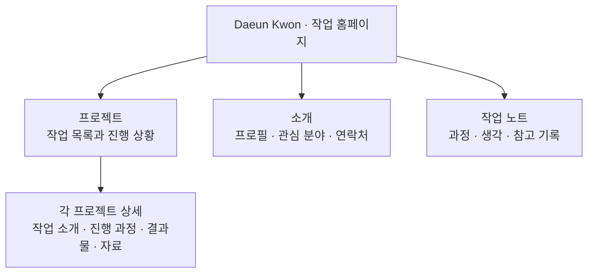
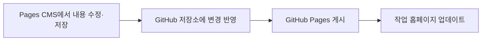

# Daeun Kwon — Projects & Notes

프로젝트와 작업 과정, 생각과 기록을 모아두는 권다은의 개인 작업 홈페이지입니다. 여러 작업을 하나의 공간에 쌓아가며, 각 프로젝트의 내용과 진행 과정을 연결합니다.

GitHub Pages + Jekyll로 만들고 Pages CMS로 내용을 관리합니다.

- 홈페이지: https://ddaeunn425.github.io/

## 홈페이지 구조도

홈페이지의 큰 틀은 **프로젝트 · 소개 · 작업 노트**입니다.



프로젝트, 소개, 작업 노트는 메인 화면 안의 섹션입니다. 프로젝트 목록에서 각 작업의 상세 페이지로 이동하고, 작업 노트는 설정한 기록 링크로 연결됩니다. 프로젝트마다 필요한 내용과 자료를 담을 수 있습니다.

## 내용과 디자인

- **홈페이지 소개와 프로필, 작업 노트**: `_data/home.json`에서 관리합니다.
- **프로젝트 목록과 본문**: `_projects/`에서 프로젝트별로 관리합니다. 새로운 작업도 이 목록에 추가합니다.
- **화면 구성과 디자인**: `_layouts/`와 `_includes/`에서 관리하며, 일반 내용 편집 화면에는 노출하지 않습니다.
- **편집기 설정**: `.pages.yml`에서 관리합니다. Pages CMS GitHub App은 홈페이지 저장소에만 연결합니다.

## 저장소 파일 구조

홈페이지 공통 구성과 프로젝트별 내용을 나누어 관리합니다. 아래는 주요 파일과 폴더입니다.

```text
ddaeunn425.github.io/
├── index.html             # 작업 홈페이지 메인 화면
├── _data/
│   ├── home.json          # 메인 소개·프로필·작업 노트
│   └── hsu.json           # 개별 프로젝트 전용 데이터
├── _projects/             # 프로젝트별 목록 정보와 본문
├── _layouts/              # 공통 및 프로젝트 상세 레이아웃
├── _includes/             # 공통 헤더·상단 메뉴·스타일
├── admin/
│   └── index.html         # 내용 편집 안내 및 편집기 링크
├── _config.yml            # 사이트 설정·프로젝트 주소 규칙
├── .pages.yml             # Pages CMS 편집 항목 설정
├── EDITING.md             # 내용 수정 안내
└── README.md              # 홈페이지 소개 및 구조
```


## 내용이 홈페이지에 반영되는 흐름



메인 화면은 `_data/home.json`과 `_projects/`의 내용을 불러옵니다. 일반 프로젝트 상세 페이지는 프로젝트 본문과 `_layouts/project.html`을 사용해 `/projects/파일명/` 주소로 생성하며, 전용 화면이 필요한 프로젝트는 별도 페이지로 연결할 수 있습니다.
