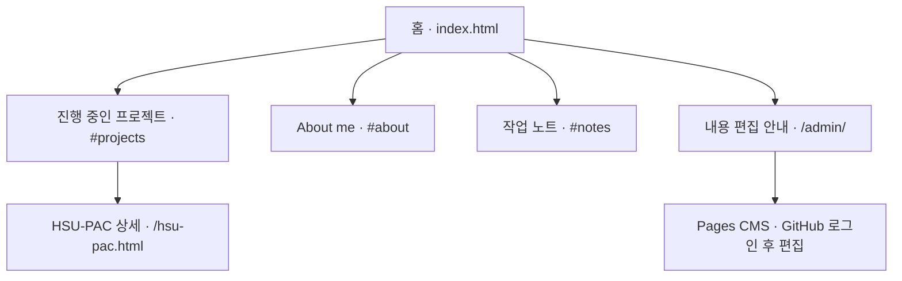

# Daeun Kwon — Projects & Notes

GitHub Pages + Jekyll + Pages CMS로 관리하는 개인 홈페이지입니다.

- 홈페이지: https://ddaeunn425.github.io/
- 편집 안내: https://ddaeunn425.github.io/admin/
- 편집기: https://app.pagescms.org/

## 내용과 디자인

`_data/home.json`은 프로필, `_projects`는 프로젝트 목록과 본문, `_data/hsu.json`은 HSU-PAC 상세 내용입니다. `_layouts`와 `_includes`는 디자인으로 일반 편집 화면에 노출하지 않습니다. `.pages.yml`은 편집기 설정입니다. Pages CMS GitHub App은 홈페이지 저장소에만 연결합니다.

## 홈페이지 구조도

메인 화면에서 프로젝트와 프로필, 작업 노트를 확인하고 HSU-PAC 상세 페이지로 이동할 수 있습니다.



Projects, About me, 작업 노트는 메인 화면 안의 섹션입니다. 작업 노트의 각 항목은 `_data/home.json`에 설정한 링크로 연결됩니다.

## 저장소 파일 구조

```text
ddaeunn425.github.io/
├── index.html                         # 메인 화면: 프로젝트·프로필·작업 노트
├── hsu-pac.html                       # HSU-PAC 상세 페이지 진입점
├── admin/
│   └── index.html                     # 내용 편집 안내 및 Pages CMS 링크
├── _data/
│   ├── home.json                      # 프로필·메인 소개·작업 노트
│   └── hsu.json                       # HSU-PAC 로드맵·장비·예산·자료
├── _projects/
│   └── hsu-pac.md                     # 프로젝트 목록 항목 및 상세 페이지 연결
├── _layouts/
│   ├── default.html                   # 공통 페이지 레이아웃
│   ├── project.html                   # 일반 프로젝트 상세 레이아웃
│   └── hsu.html                       # HSU-PAC 전용 상세 레이아웃
├── _includes/
│   ├── head.html                      # 공통 문서 헤더
│   ├── style.html                     # 공통 스타일
│   └── top.html                       # 상단 메뉴
├── _config.yml                        # Jekyll 설정·프로젝트 URL 규칙
├── .pages.yml                         # Pages CMS 편집 항목 설정
├── EDITING.md                         # 내용 수정 안내
├── README.md                          # 홈페이지 소개 및 구조도
├── HSU-PAC-equipment-selection.docx    # 장비 선정 문서
└── HSU-PAC-network-plan.docx           # 통신망 구축 계획 문서
```

### 내용이 화면에 반영되는 흐름

- `_data/home.json` → `index.html` → 메인 소개·프로필·작업 노트
- `_projects/*.md` → `index.html`의 프로젝트 목록. 현재 HSU-PAC 항목은 `/hsu-pac.html`로 연결
- `_data/hsu.json` → `_layouts/hsu.html` → HSU-PAC 상세 화면
- 일반 프로젝트는 `_projects/*.md`의 본문과 `_layouts/project.html`을 사용하며, `/projects/파일명/` 주소로 생성
- Pages CMS에서 저장 → GitHub 저장소 변경 → GitHub Pages 게시 후 홈페이지 반영
